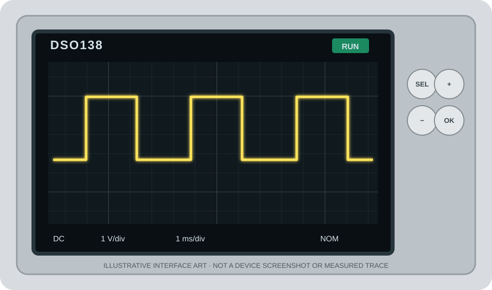

# DSO138 Oscilloscope Firmware

C++17 firmware for the JYE Tech DSO138 digital oscilloscope, built with STM32 HAL for the STM32F103C8T6 in STM32CubeIDE. This repository provides the application source, CubeIDE project, and practical documentation for owners and developers.

[User manual (PDF)](docs/manual/dso138-user-manual.pdf) · [Getting started](docs/getting-started.md) · [Build instructions](docs/building.md) · [Compatibility](docs/compatibility.md) · [Trigger LED](docs/trigger-led.md)

*Illustrative interface artwork, not a device screenshot or measured trace.*

> **Before flashing:** the reference hardware is PCB **109-13800-00C**, **STM32F103C8T6** and **ILI9341**. Configure your own MCU identity using [Getting started](docs/getting-started.md). Other variants are unverified, and nominal readings require individual calibration.

## Features

| Area | Included functionality |
| --- | --- |
| Acquisition | Timer-triggered ADC with DMA; configured rate up to 500 kS/s |
| Timebase | 24 settings from 10 µs/div to 500 s/div; filtered rolling view for slow settings |
| Controls | Auto, Normal and Single trigger, Run/Hold, trigger position, physical switches and four buttons |
| Trigger indication | D3 flashes on accepted trigger crossings; see [Trigger LED behavior](docs/trigger-led.md) |
| Measurements | Frequency, peak-to-peak, mean and RMS when valid for the capture |
| Records | Save and recall waveforms and settings; independent calibration store |

The unreleased revision uses one 2 KiB storage bank, leaving 62 KiB for application code. Reset or power loss during a save can lose the saved waveform, settings and calibration. Wait for completion before removing power. Records from the previous two-bank layout are not guaranteed to migrate; its lower bank becomes application space.

## Quick start

1. Read [Getting started](docs/getting-started.md): identify the board, set its MCU UID and identity, and make a complete Flash backup.
2. Follow [Building](docs/building.md) to import `firmware/` as an existing STM32CubeIDE project and build the Release configuration.
3. Review [Compatibility](docs/compatibility.md) before using another board revision. For common startup and signal issues, see [Troubleshooting](docs/troubleshooting.md).

The checked toolchain is STM32CubeIDE 2.2.0 with GNU Tools for STM32 14.3.rel1; the CubeMX configuration was generated with 6.18.1. Do not casually regenerate the `.ioc` file. It is maintained as the hardware design reference; regeneration would add the usual generated C entry/startup support and requires manual integration with this project's C++ startup and interrupt owners.

The image is identity-bound and must be built for each MCU. No universal prebuilt image is provided. This source does not include JYE Tech binary firmware or DLO138 implementation code.

## Documentation

- [User manual (PDF)](docs/manual/dso138-user-manual.pdf) · [LaTeX source](docs/manual/dso138-user-manual.tex)
- [Architecture overview](docs/architecture.md)
- [Contributing](CONTRIBUTING.md)
- [Changelog](CHANGELOG.md)

## License

The application and documentation are licensed under the [MIT License](LICENSE). Third-party components retain their own terms; see [third-party notices](THIRD_PARTY_NOTICES.md).
